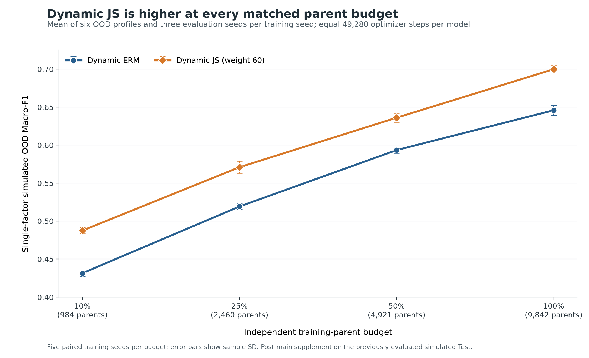

# Same-parent supervision for PXRD classification

**Simulator-retained identity between measurements of the same crystal supplies physical relation supervision for seven-crystal-system PXRD classification.** This study tests whether that relation adds value beyond crystal-system labels alone.

[Supervisor guide](docs/START_HERE_FOR_SUPERVISORS.md) · [Full results and limitations](xrd_robustness/reports/RESULTS.md) · [Code and experiment contract](xrd_robustness/) · [Research history](docs/PROJECT_HISTORY.md)

## The method

For a crystal structure <code>s</code>, the online simulator produces two measurements, <code>x₁ = g(s, m₁)</code> and <code>x₂ = g(s, m₂)</code>, under different measurement conditions. The parent identity is retained, so the two patterns provide a relation in addition to their shared seven-class label.

The controlled comparison uses **two-view Dynamic ERM** and **two-view Dynamic JS**. Both train on the same two views with the same labels. Dynamic JS adds a Jensen–Shannon consistency penalty between the two predicted class distributions (<code>λJS = 60</code>). Both use the same ResNet-18-GN backbone, parent-disjoint split, perturbation protocol, and matched training seeds. The consistency weight of 60 was selected on validation. The contrast is the consistency loss; this work does not claim to invent JS divergence, online simulation, or the backbone.

## Evidence at a glance

The primary classification study uses 14,060 unique parent structures (9,842 train / 2,109 validation / 2,109 test) and five matched training seeds.

| Evaluation | Dynamic ERM Macro-F1 | Dynamic JS Macro-F1 | Paired JS − ERM |
|---|---:|---:|---:|
| **Simulated Test, mean across six single-factor OOD profiles** | 0.6507 ± 0.0072 | **0.7053 ± 0.0098** | **+0.0546**; 5/5 seeds positive |
| **RRUFF-301, K=1 real labels per class** | 0.2847 ± 0.0269 | **0.3280 ± 0.0329** | **+0.0433** |
| **RRUFF-301, K=2 real labels per class** | 0.3026 ± 0.0407 | **0.3486 ± 0.0335** | **+0.0460** |
| **RRUFF-301, K=5 real labels per class** | 0.3555 ± 0.0302 | **0.4099 ± 0.0271** | **+0.0545** |
| **CNRS-318, zero-shot external source** | 0.1884 ± 0.0263 | **0.2071 ± 0.0213** | **+0.0187**; 5/5 seeds positive |

For the main simulated comparison, the error terms are sample SD across five training seeds. RRUFF values summarize 25 paired runs per label budget. CNRS summarizes five training seeds. The CNRS class-stratified paired-parent 95% interval for the Macro-F1 gain crosses zero; absolute performance is weak and accuracy remains below the majority-class baseline. RRUFF measures adaptation on a curated domain, not unseen-mineral generalization.

### Parent-structure data-efficiency supplement

The four-point curve is a core result. It plots **absolute** single-factor simulated OOD Macro-F1 at 10%, 25%, 50%, and 100% of the 9,842 training parents. Each method received 49,280 optimizer steps per model; five matched seeds were completed at every budget (40/40 method runs). Each seed score averages six single-factor OOD profiles over three frozen evaluation seeds; table uncertainty is sample SD across the five training seeds.

| Train parents | Dynamic ERM, mean ± SD | Dynamic JS, mean ± SD | Paired JS − ERM, mean (95% paired CI) |
|---:|---:|---:|---:|
| 984 (10%) | 0.4316 ± 0.0044 | **0.4876 ± 0.0039** | +0.0561 [0.0509, 0.0615] |
| 2,460 (25%) | 0.5193 ± 0.0036 | **0.5710 ± 0.0080** | +0.0517 [0.0458, 0.0573] |
| 4,921 (50%) | 0.5935 ± 0.0041 | **0.6361 ± 0.0059** | +0.0426 [0.0370, 0.0476] |
| 9,842 (100%) | 0.6459 ± 0.0065 | **0.6999 ± 0.0050** | +0.0540 [0.0477, 0.0603] |

These are same-budget performance differences, **not demonstrated savings in the number of structures required**. The supplement reused the previously evaluated simulated Test and is post-main evidence, not an untouched confirmatory test. The [full protocol and audit report](xrd_robustness/reports/PARENT_BUDGET_EFFICIENCY.md) links the machine-readable JSON/CSV and [figure-generation script](xrd_robustness/scripts/generate_showcase_parent_budget_figure.py).

## Project status and credit

- **Completed classification study:** matched Dynamic ERM vs Dynamic JS, simulated OOD, RRUFF few-shot adaptation, and CNRS zero-shot evaluation; manuscript preparation continues.
- **Ongoing exploratory inversion track:** known-phase, single-phase tetragonal PXRD work. Main-branch numerical infrastructure is separate from the classification study; it is not a completed machine-learning inversion result.
- **Automation engineering:** research-task and status-delivery tooling supports experiment operations; it is engineering work, not evidence for the classification claim.

**Research leadership:** Frysland-2024 led the project's scientific direction and study design. **Execution and engineering contributions:** Cuifa01 contributed supporting ideas, data organization, implementation, GPU experiments, and reporting. See the [research-role statement](docs/RESEARCH_ROLES.md) for detail; formal manuscript authorship remains a separate scholarly decision.

## Quick start

Verify the public non-data-bound code and evidence contracts:

~~~bash
git clone https://github.com/Frysland-2024/AI4science.git
cd AI4science/xrd_robustness
python -m pip install -e ".[test]"
python -m pytest -q -m "not data_bound"
~~~

This does not reproduce the historical GPU training. External crystal datasets, raw spectra, trained checkpoints, and generated caches are not redistributed. The package [README](xrd_robustness/README.md) documents the training entry point and code layout; see the [data and reproducibility policy](docs/DATA_AND_REPRODUCIBILITY.md).

## Further reading

[Five-minute reviewer guide](docs/REVIEWER_GUIDE.md) · [Current scientific state](docs/CURRENT_STATE.md) · [Supervision framing](docs/PXRD_SUPERVISION_FRAMING.md) · [Novelty and literature lineage](docs/PXRD_NOVELTY_LITERATURE_LINEAGE.md) · [Manuscript scaffold](xrd_robustness/MANUSCRIPT.md) · [Third-party notices](THIRD_PARTY_NOTICES.md) · [MIT license](LICENSE)

Citation details are recorded in [CITATION.md](CITATION.md).
