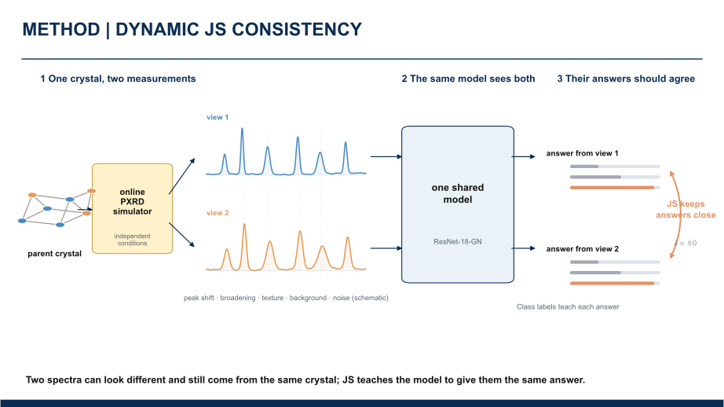
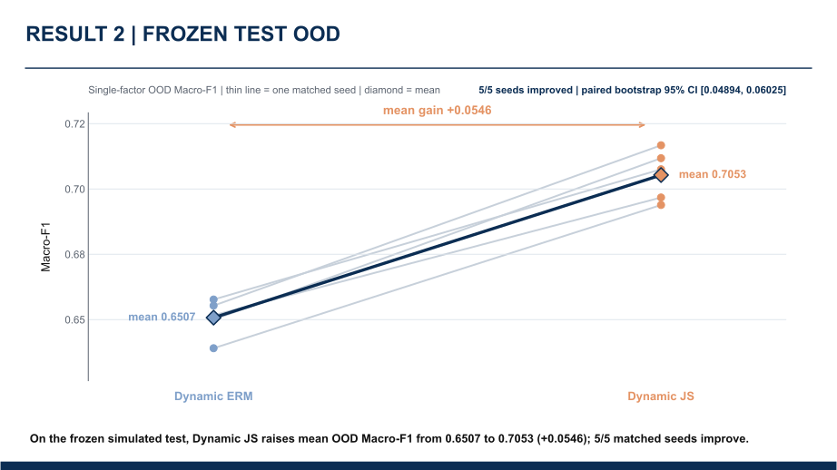

# AI4science | Learning from PXRD simulations

[Research guide](docs/REVIEWER_GUIDE.md) · [Results & limitations](xrd_robustness/reports/RESULTS.md) · [Main implementation](xrd_robustness/) · [Research evolution](docs/PROJECT_HISTORY.md)

**Research focus:** supervised machine learning for **seven-crystal-system classification from powder X-ray diffraction (PXRD)**. We investigate whether a simulator can provide more than synthetic patterns and class labels: **it also knows which different measurements come from the same parent crystal.**

**中文一句话：** 用同一晶体在不同测量条件下产生的两张 XRD 模拟谱，构造“同源关系监督”，并检验它是否比普通动态数据增强更有利于晶系识别、抗扰动和少量真实谱适配。

**Status (October 2026):** the main Dynamic ERM vs Dynamic JS comparison and its simulated/experimental evaluations are completed; manuscript preparation is ongoing. A separate PXRD inversion numerical track exists, while the proposed undergraduate thesis direction is **not a completed result**; the parent-budget learning-curve supplement is **completed**.

## The idea, in one figure

A parent crystal structure has a fixed crystal-system label, but its measured diffraction pattern changes with peak shift, broadening, preferred orientation, background, and noise.

- **Standard use of a simulator:** generate many labeled PXRD patterns and train a classifier.
- **This study:** retain the *same-parent* relationship between two independently perturbed observations; use that relationship as an additional consistency signal.
- **Controlled question:** with **identical parent structures, two-view exposure, perturbation distribution, backbone and training budget**, does explicit same-parent consistency improve generalization beyond Dynamic ERM?

For simulated views **x₁ = g(s, m₁)** and **x₂ = g(s, m₂)** from the same structure **s**, the supervised objectives are:

~~~text
Dynamic ERM:  L = 0.5 CE(p1, y) + 0.5 CE(p2, y)
Dynamic JS:   L = 0.5 CE(p1, y) + 0.5 CE(p2, y) + λ · JS(p1, p2)
~~~

Here **p1** and **p2** are the predicted seven-class distributions; **λ = 60** was selected on validation. Both methods use the same **ResNet-18-GN** backbone. The contribution is **using simulator-retained provenance as relationship supervision**, **not** inventing JS divergence, online simulation, or the ResNet architecture.

## Results at a glance

The primary simulated study uses **14,060 unique parent structures** (9,842 train / 2,109 validation / 2,109 test), separated at the parent level, with **five matched training seeds**.

| Evaluation (Macro-F1 unless noted) | Dynamic ERM | Dynamic JS | JS − ERM |
|---|---:|---:|---:|
| **Simulated Test:** mean single-factor OOD | 0.6507 | **0.7053** | **+5.46 percentage points**; 5/5 seeds |
| **RRUFF-301:** 1 real label / class | 0.2847 | **0.3280** | **+4.33 pp** |
| **RRUFF-301:** 2 real labels / class | 0.3026 | **0.3486** | **+4.60 pp** |
| **RRUFF-301:** 5 real labels / class | 0.3555 | **0.4099** | **+5.45 pp** |
| **CNRS-318:** zero-shot external source, seed-level mean | 0.1884 | **0.2071** | **+1.87 pp**; 5/5 seeds |

**How to interpret the three evaluations:**

1. **Simulated OOD:** the same-parent consistency objective improves classification under held-out measurement perturbations. The largest profile-specific gains occur for **peak broadening and preferred orientation**; see [perturbation evidence](docs/PXRD_PERTURBATION_EVIDENCE.md) and the [full results](xrd_robustness/reports/RESULTS.md).
2. **RRUFF-301 few-shot:** the pretrained models are adapted using the **same small real-label budgets**. The comparison concerns **label efficiency on this curated experimental domain**, *not* generalization to unseen minerals.
3. **CNRS-318 zero-shot:** the frozen simulated-data-trained models are tested on an **independent, naturally imbalanced experimental source**, without CNRS-label tuning. This is a **relative cross-domain comparison**, not a high-accuracy application claim: absolute performance is low; CNRS accuracy remains below its majority-class baseline, and a parent-level bootstrap interval for the Macro-F1 gain crosses zero.

Across secondary reliability analyses, ECE/NLL/Brier generally improve as well, but these are supporting measures rather than the principal contribution. Precise mean ± SD, paired designs, statistical uncertainty, dataset limitations, and per-class behavior are preserved in [RESULTS.md](xrd_robustness/reports/RESULTS.md), [CNRS details](xrd_robustness/reports/CNRS_318_RESULTS.md), and [calibration analysis](xrd_robustness/reports/CALIBRATION_ANALYSIS.md). Machine-readable [validation results](xrd_robustness/reports/validation_results.json), [simulated Test](xrd_robustness/reports/simulated_test_results.json), and [RRUFF few-shot](xrd_robustness/reports/rruff301_fewshot_results.json) summaries are tracked.

## What is actually implemented?

| Research/engineering component | Inspect the evidence or code |
|---|---|
| **Physics-motivated PXRD measurement simulation** and online generation of paired views | [Simulator](xrd_robustness/src/xrd_robustness/simulator.py) · [Online views](xrd_robustness/src/xrd_robustness/online_views.py) · [Frozen simulation config](xrd_robustness/configs/simulation.method_transfer.frozen.json) |
| **Parent-disjoint structure splits** and dataset construction | [Structure-split code](xrd_robustness/src/xrd_robustness/structure_split.py) · [Public experiment contract](xrd_robustness/configs/experiment.public.json) |
| **Matched two-view ERM / JS training**, shared 1D ResNet backbone | [Training objectives](xrd_robustness/src/xrd_robustness/training/objectives.py) · [Training runner](xrd_robustness/src/xrd_robustness/training/runner.py) · [ResNet](xrd_robustness/src/xrd_robustness/models/ml4pxrd_resnet1d.py) |
| **Frozen OOD/real-domain evaluation**, reproducibility and leakage checks | [Evaluation scripts](xrd_robustness/scripts/) · [Evidence audit](docs/PXRD_METHOD_DETAIL_EVIDENCE_CLOSURE.md) · [Tests](xrd_robustness/tests/) |
| **Result interpretation and scientific reporting** | [Results](xrd_robustness/reports/RESULTS.md) · [Manuscript draft](xrd_robustness/MANUSCRIPT.md) · [Figures](xrd_robustness/figures/) |

This is a **controlled application of established ML components to a physically structured supervision problem**. The 1D ResNet implementation draws on the MIT-licensed **ML4pXRDs** codebase; see [third-party notices](THIRD_PARTY_NOTICES.md).

## Explore the repository

| Track | Status | Purpose |
|---|---|---|
| **[xrd_robustness/](xrd_robustness/)** | **Completed experiments / writing** | Main PXRD classification study: matched ERM–JS, simulated OOD, RRUFF few-shot, CNRS zero-shot |
| **[xrd_inversion/](xrd_inversion/)** | **Separate numerical research infrastructure** | Known-phase tetragonal PXRD forward/inversion validation; numerical gates have results, **not** a completed ML inversion claim |
| **[Parent-budget efficiency results](xrd_robustness/reports/PARENT_BUDGET_EFFICIENCY.md)** | **Completed supplementary experiment** | 40 runs; four parent budgets, five seeds, improved same-budget performance but no demonstrated quantitative structure saving |
| **[docs/FUTURE_UNDERGRAD_THESIS_PLAN.md](docs/FUTURE_UNDERGRAD_THESIS_PLAN.md)** | **Historical 2026-10-08 candidate; not started** | Initial concept: physics-constrained continuous-parameter inversion thesis |
| **[docs/FERROELECTRIC_PRE_REFINEMENT_12W_PLAN.md](docs/FERROELECTRIC_PRE_REFINEMENT_12W_PLAN.md)** | **Proposed 2026-10-18; not started** | 12-week simulation-trained, calibrated Top-K phase/parameter pre-refinement assistance; coexistence treated as a mandatory single-phase failure stress test |

For the reasoning behind changes such as **PAMPT → ResNet**, abandonment of the Residual branch, and the shift from generic robustness framing to relationship supervision, see the [project history](docs/PROJECT_HISTORY.md). Negative and archived results are intentionally retained.

## Verify the public code

~~~bash
git clone https://github.com/Frysland-2024/AI4science.git
cd AI4science/xrd_robustness
python -m pip install -e ".[test]"
python -m pytest -q -m "not data_bound"
~~~

This verifies the **public, non-data-bound code and evidence contracts**, **not** the full historical GPU training. Raw external datasets, trained checkpoints and large intermediate data are not redistributed. See [data and reproducibility levels](docs/DATA_AND_REPRODUCIBILITY.md) and the package [quick-start guide](xrd_robustness/README.md).

## For academic readers

- **[5-minute research / reviewer guide](docs/REVIEWER_GUIDE.md):** which files answer the scientific and ML questions.
- **[Current scientific state](docs/CURRENT_STATE.md):** authoritative status and claim boundaries.
- **[Supervision framing](docs/PXRD_SUPERVISION_FRAMING.md):** why the method is about same-parent relations, not a new divergence.
- **[Literature lineage](docs/PXRD_NOVELTY_LITERATURE_LINEAGE.md):** precedents and novelty boundaries.
- **[Research timeline](docs/PROJECT_HISTORY.md):** documented decisions, failed attempts and redirections.
- **[Manuscript scaffold](xrd_robustness/MANUSCRIPT.md):** paper-oriented narrative, with writing still in progress.

**Citation:** a paper citation will be added after the author list and identifier are finalized. Until then, cite the [repository](https://github.com/Frysland-2024/AI4science) with the commit hash; see [CITATION.md](CITATION.md). **License:** [MIT](LICENSE).

## Parent-structure budget efficiency supplement (completed 2026-10-14)

This follow-up used four independent training-parent budgets (984 / 2,460 / 4,921 / 9,842), five matched seeds and equal 49,280-step training budgets per model: **40/40 completed runs**. On the previously used simulated Test, paired mean single-factor OOD Macro-F1 improvements from Dynamic JS over ERM were **+0.0561 / +0.0517 / +0.0426 / +0.0540** respectively (5/5 positive seeds at every budget). **This supports improved same-budget performance, not a measured reduction in the number of parent structures needed**. It is a post-main supplementary analysis, not an untouched blind Test. See [report](xrd_robustness/reports/PARENT_BUDGET_EFFICIENCY.md) and [machine-readable results](xrd_robustness/reports/parent_budget_efficiency/).

### Research roles and contributions

**Overall scientific direction, planning, and experimental design — Frysland-2024 (project lead):** The research lead originated, planned, and directed the project's scientific program and was principally responsible for designing its research approaches and experiments throughout its development. This includes the same-parent consistency strategy, simulated OOD protocols, both experimental-domain studies (RRUFF and CNRS), the parent-budget / Data Efficiency study, decisions about changes in the research direction, and interpretation of results.

**Research assistance and execution — Cuifa01 (contributor):** Participated primarily in carrying out the lead-designed research plans; offered supporting ideas and feedback, helped gather and organize data, and contributed code implementation, experiment operations, GPU training, desktop migration, reporting artifacts, and other execution tasks. These are recognized contributions, but they should not be confused with primary authorship of the research design or overall project planning.

**Attribution note:** This division of responsibility reflects the research lead's clarification; Git commit history and individual implementation credits remain unchanged. A future paper's formal authorship and contribution statement should be agreed according to each person's actual scholarly contributions.
