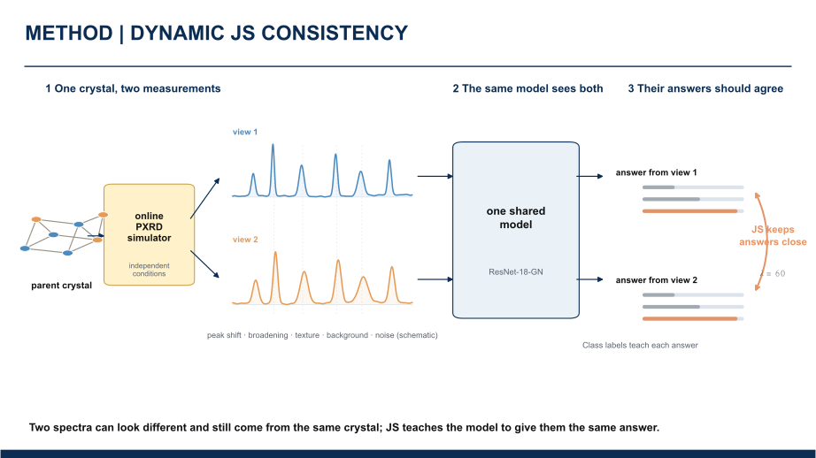

# AI4Science — PXRD Crystal-System Classification

**Research focus:** Learning to identify the seven crystal systems from powder X-ray diffraction (PXRD) patterns, with simulated measurement variation and same-parent consistency supervision.

This repository contains the research code, reproducible experiment records and results for an undergraduate AI-assisted materials-characterization project.

## Research idea

Different simulated measurements of the same parent crystal share the same crystal-system label. We compare conventional **Dynamic ERM** with **Dynamic JS**, which additionally encourages consistent predictions across paired measurements of the same parent. The contribution investigated here is the use of simulator-known parent identity as relationship supervision, not the invention of JS divergence.

## Completed evidence

| Evaluation | Reported outcome | Important limit |
|---|---|---|
| Simulated OOD (five matched seeds) | Macro-F1: ERM **0.6507**, JS **0.7053** (+5.46 pp) | Historical 14,060-parent study, not a real-spectrum score |
| RRUFF-301 few-shot adaptation | Macro-F1 improvement: **+4.33 / +4.60 / +5.45 pp** at K=1/2/5 | Few-shot, not zero-shot |
| CNRS-318 zero-shot | Paired Macro-F1 gain +1.87 pp; accuracy 0.200 → 0.210 | Below majority baseline; uncertainty interval crosses zero |
| Simulated parent-budget comparison | JS higher OOD Macro-F1 at four tested budgets | Supplementary post-main analysis, not proven structure savings |

Read the [full results and caveats](xrd_robustness/reports/RESULTS.md), [calibration analysis](xrd_robustness/reports/CALIBRATION_ANALYSIS.md) and [data-efficiency report](xrd_robustness/reports/PARENT_BUDGET_EFFICIENCY.md).

## Current development (November 2026)

The project has resumed development toward a larger-scale seven-system classification benchmark; the older October 2026 *write-up only* freeze is historical.

- **Simulator:** the versioned simulator integration was merged in [PR #58](https://github.com/Frysland-2024/AI4science/pull/58). Integration tests are not evidence of completed large-scale model training.
- **Data:** a structure-only library of **154,975 MP-ID records / 154,968 parent groups** has been reported as collected and split (108,478 train / 23,245 validation / 23,245 synthetic test parent groups). V11 loader, PeakTable/cache and corpus-level readiness are still pending; see [#61](https://github.com/Frysland-2024/AI4science/issues/61).
- **Next:** after data readiness and explicit GPU provisioning, bounded model tuning on the full new training parent set; see [#55](https://github.com/Frysland-2024/AI4science/issues/55).
- **Target evaluation:** the frozen **RRUFF-Cu1011** real-domain primary benchmark (1,011 spectra), independent-parent data-efficiency curve, and calibration (ECE). The benchmark protocol and sample membership are documented in [PR #68](https://github.com/Frysland-2024/AI4science/pull/68) and are not yet merged into main. **No final new-data or RRUFF-Cu1011 model score is claimed yet.**

## Code and reproducibility

- [Experiment code and commands](xrd_robustness/README.md)
- [Reproducibility and data policy](docs/DATA_AND_REPRODUCIBILITY.md)
- [Full research results](xrd_robustness/reports/RESULTS.md)
- [Current project state](docs/CURRENT_STATE.md)
- [V11/cloud HPO execution plan](docs/PXRD_154975_CLOUD_HPO_EXECUTION_PLAN_20261103.md)
- [Integrated V11 Linux migration and deterministic prefetch pipeline](server_migration/README.md) — code and offline CI validated; cloud GPU run still pending
- [Project history and archived directions](docs/PROJECT_HISTORY.md) · [Archive guide](archive/README.md)

Experimental files and local datasets may not all be distributed in this repository; consult the data policy and evidence manifests before attempting reproduction.

## Project history

The research evolved from **FerroAI → PXRD classification → same-parent supervision → exploratory parameter inversion → return to seven-system classification**. The inversion/DONUT/AutoLab work is historical, not an active thesis deliverable. The full decision trail and negative results remain available through the archive guide, linked reports and Git history; they are intentionally not reproduced on the public landing page.

[License](LICENSE) · [Citation](CITATION.md) · [Third-party notices](THIRD_PARTY_NOTICES.md)
