# AI4Science: PXRD Seven-Crystal-System Classification

**Active scientific task (decision dated 2026-10-23):** machine-learning prediction of the seven crystal systems from powder X-ray diffraction (PXRD) measurements.

The completed study tests whether **Shared Parent Identity → Measurement Equivalence → Relationship Supervision** improves classification. The next stage will strengthen real-domain performance, confidence calibration, and use of independent simulated structures. Quantitative parameter inversion is archived and inactive.

## Project Overview

This repository contains a completed ResNet-18-GN comparison of **Dynamic ERM** and **Dynamic JS Consistency**, plus a future plan to improve seven-system classification. The simulator generates two measurement views from the same unchanged parent crystal; Dynamic JS uses that known relationship as additional supervision.

**What is complete:** controlled method comparisons, simulated out-of-distribution (OOD) evaluation, historical RRUFF-301 few-shot adaptation, simulated/CNRS calibration audits, and a parent-structure budget study.

**What is next:** three evaluation axes only—RRUFF real-domain performance, confidence calibration, and simulated-data efficiency. The larger-data simulator and training changes are plans, not completed work.

## Scientific Motivation & Method

A simulated PXRD spectrum has a known crystal-system label and a known parent-structure identity. Two spectra generated from the same parent represent different measurements of the same crystal. The study asks whether using this measurement relationship adds value beyond ordinary class-label supervision.

The method contribution is the use of simulator-retained parent identity as relationship supervision. JS consistency is its tested implementation; the project does not claim to have invented JS consistency.

Earlier project context figures (slides 01–09)

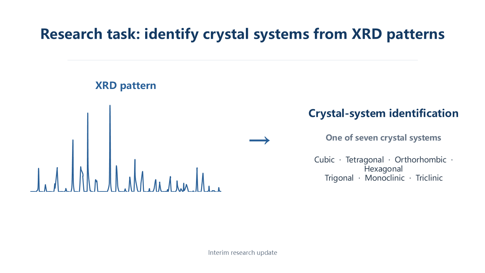

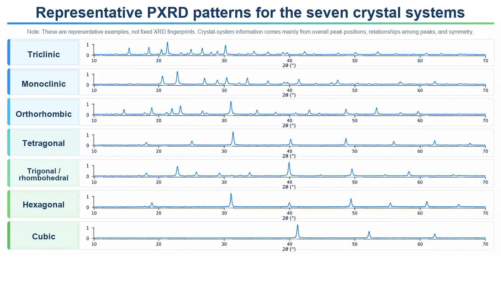

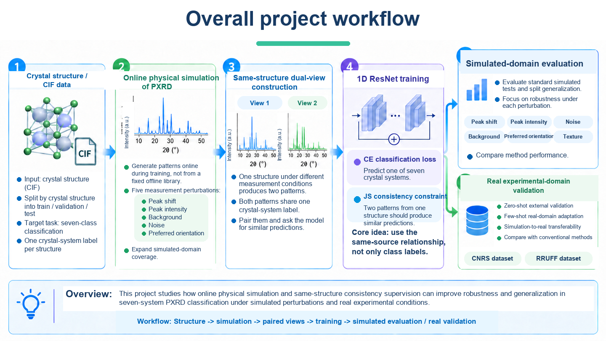

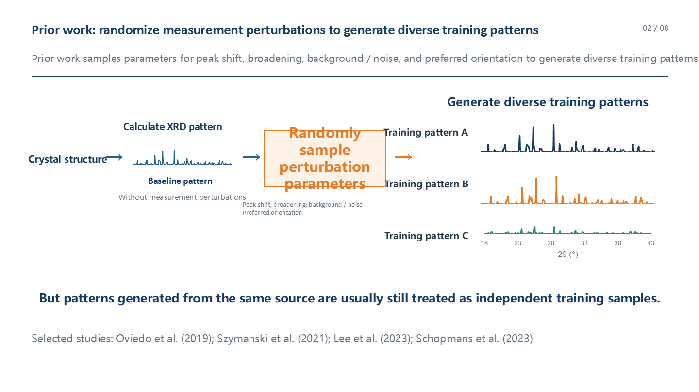

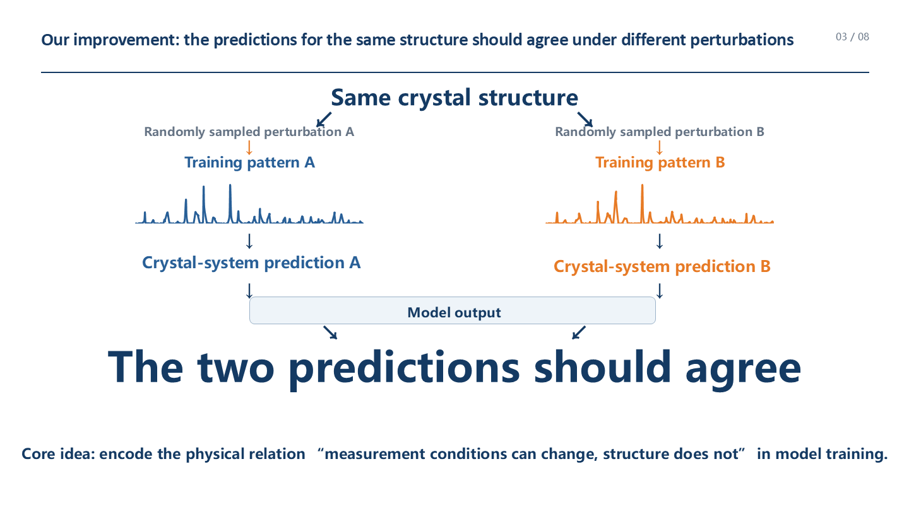

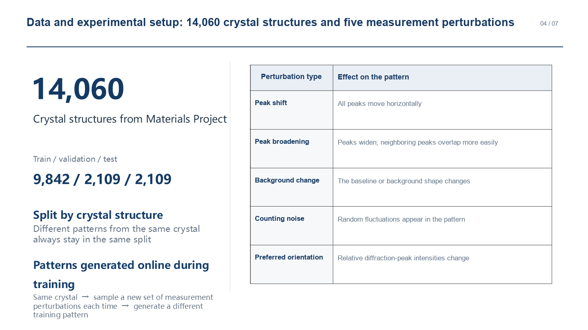

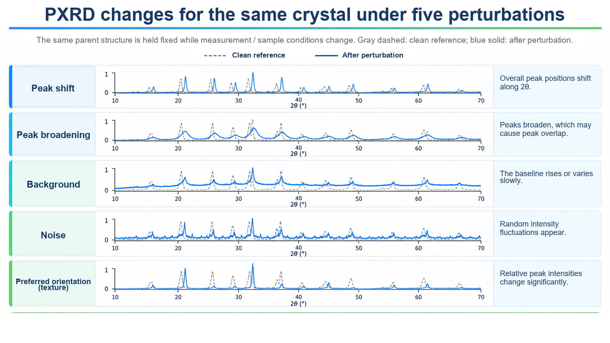

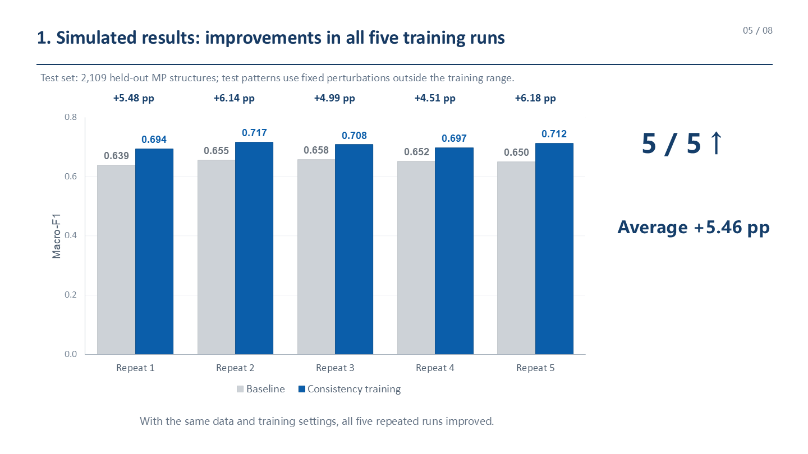

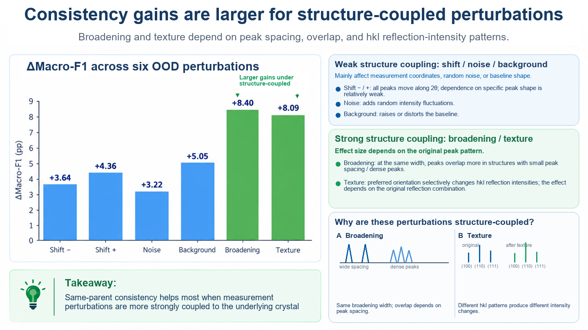

## Completed Research

| Evidence | Completed result | Boundary |
|---|---|---|
| Simulated OOD classification | Test Macro-F1: Dynamic ERM **0.6507**; Dynamic JS **0.7053**; paired gain **+5.46 percentage points** across five matched seeds. | Frozen 14,060-parent study; not a real-domain score. |
| RRUFF-301 few-shot | Macro-F1 gains at K=1/2/5: **+4.33 / +4.60 / +5.45 pp**. | Historical few-shot adaptation evidence; it is not the new zero-shot benchmark. |
| Confidence calibration | Existing simulated-Test and CNRS analyses report ECE, NLL, and Brier; see the frozen analysis. | These do not establish calibration on the planned RRUFF evaluation. |
| CNRS-318 zero-shot | Paired seed-level Macro-F1 gain **+1.87 pp**; pooled accuracy **0.200 → 0.210**, below the 0.274 majority baseline. The corrected paired-parent 95% interval crosses zero. | Optional secondary domain; keep the completed result and its limits visible when making broad generalization claims. |
| Simulated parent-budget study | Dynamic JS had higher OOD Macro-F1 at all four matched budgets (10/25/50/100% of the original training parents). | Post-main use of an already evaluated simulated Test; it does **not** demonstrate a measured number of structures saved. |

Detailed numbers, uncertainty, frozen test caveats, and machine-readable evidence are in [the results report](xrd_robustness/reports/RESULTS.md), [calibration analysis](xrd_robustness/reports/CALIBRATION_ANALYSIS.md), and [parent-budget report](xrd_robustness/reports/PARENT_BUDGET_EFFICIENCY.md).

## Three Core Evaluation Axes

| Axis | Primary evidence | Current status and guardrail |
|---|---|---|
| **A. RRUFF real-domain benchmark** | Seven-system zero-shot Accuracy and Macro-F1; compare Lee (2023), SimXRD-4M (2025), and XQueryer-NoElem (2025) on the same spectra and evaluation conditions wherever possible. | New aligned benchmark is planned. Literature scores under different curation, labels, or protocols are reference points, not a fair ranking. Keep K=1/2/5 few-shot results separate. |
| **B. Confidence calibration** | Expected Calibration Error (ECE); NLL, Brier score, and reliability diagrams as supporting evidence. | Existing simulated-domain/CNRS results are historical. The new RRUFF calibration evaluation remains to be done and must identify its prediction panel and calibration protocol. |
| **C. Simulated-data efficiency** | Classification performance versus the number of **independent training parent structures**, with matched Dynamic ERM and Dynamic JS budgets. | The existing 10/25/50/100% study is supplementary evidence. Expand to larger feasible structure counts; same-budget accuracy gains do not prove a specific data saving. |

CNRS is an **Optional Secondary Experimental Domain**, not a fourth evaluation axis.

## Future Research Roadmap

All items below are planned work, not completed experiments.

1. **P1 — Expand independent training structures.** Audit the available structures per crystal system and attempt approximately 30k, 60k, and 100k unique training parents only where acquisition, deduplication, labels, and split audits support them. Start from the historical 14,060-structure dataset; do not count repeated perturbations as new structures.
2. **P1 — Upgrade the online dynamic PXRD simulator.** Evaluate SimXRD/Pysimxrd as references; consider Caglioti/Scherrer broadening, pseudo-Voigt profiles, Cu Kα doublet, and instrument variation in a versioned implementation. Preserve physically valid same-parent views and the crystal-system label; do not introduce unverified lattice deformation.
3. **P1 — Retune training for the new data and simulator.** Reassess learning rate, batch size, scheduler, training steps/parent exposure, and JS weight using development evidence. Historical JS weight 60 remains a frozen result, not a required scale-up choice.
4. **P2 — Compare model architectures conditionally.** Keep ResNet-18-GN as the historical baseline. After the data and simulator stabilize, consider SimXRD CNN11 and optionally a multi-scale 1D CNN. A large Transformer or a new architecture is not required.

The full sequence and acceptance boundaries are in the [2026-10-23 scale-up plan](docs/PXRD_SCALEUP_SIMULATOR_AND_TUNING_PLAN_20261023.md). This task does not authorize training, downloading data, or implementation.

## Reproducibility & Results

- [Start here for supervisors](docs/START_HERE_FOR_SUPERVISORS.md)
- [Frozen results and limitations](xrd_robustness/reports/RESULTS.md)
- [Data and reproducibility policy](docs/DATA_AND_REPRODUCIBILITY.md)
- [Experiment protocol and code](xrd_robustness/README.md)
- [RRUFF literature benchmark plan](docs/RRUFF_REAL_DOMAIN_LITERATURE_BENCHMARK_2026-10-22.md)
- [Calibration report](xrd_robustness/reports/CALIBRATION_ANALYSIS.md)
- [Parent-budget protocol and report](xrd_robustness/reports/PARENT_BUDGET_EFFICIENCY.md)
- [Current project state](docs/CURRENT_STATE.md) · [Project history](docs/PROJECT_HISTORY.md)
- [Manuscript](xrd_robustness/MANUSCRIPT.md)
- [Validation results JSON](xrd_robustness/reports/validation_results.json)
- [Simulated-test results JSON](xrd_robustness/reports/simulated_test_results.json)
- [RRUFF-301 few-shot results JSON](xrd_robustness/reports/rruff301_fewshot_results.json)
- [Citation](CITATION.md) · [License](LICENSE) · [Third-party notices](THIRD_PARTY_NOTICES.md)

Selected evidence figures:

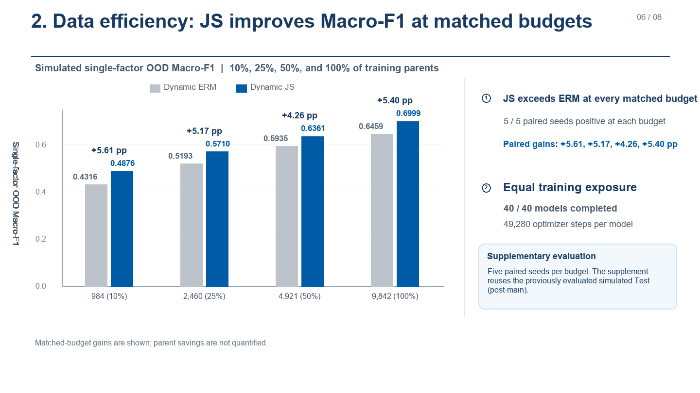

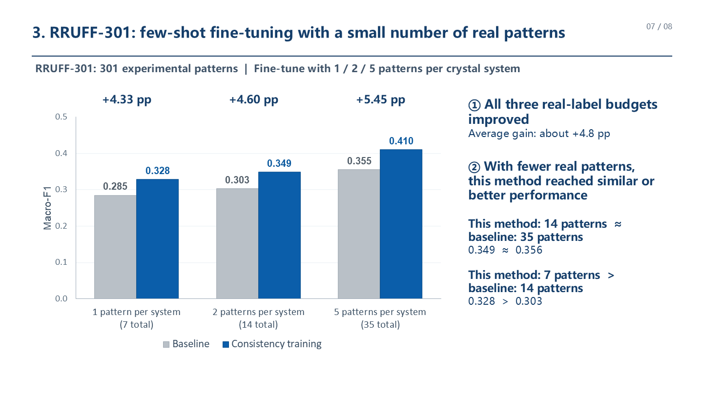

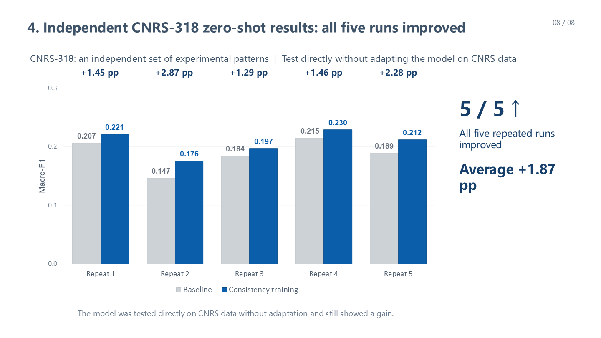

The source images and prior presentation files are preserved in [docs/showcase](docs/showcase/). The prior [slide 13](docs/showcase/13_next_stage_HISTORICAL_20261023.png), [PDF](docs/showcase/AI4science_showcase_EN_HISTORICAL_20261023.pdf), and [PowerPoint](docs/showcase/AI4science_showcase_EN_HISTORICAL_20261023.pptx) are explicitly marked as historical; see the [archive note](docs/showcase/HISTORICAL_PRESENTATION.md). Use this README and the scale-up plan for the current roadmap.

## Research History

The project path is preserved in [Project History](docs/PROJECT_HISTORY.md): **FerroAI → PXRD classification → same-parent relationship-supervision method research → quantitative parameter-inversion exploration → return to seven-crystal-system classification**.

The inversion, Forward Reconstruction Loss, DONUT-inspired, automatic-refinement, and ferroelectric pre-refinement proposals remain available as historical records and code where applicable. They are **Archived / Inactive**; an old proposal or issue does not reactivate them.
