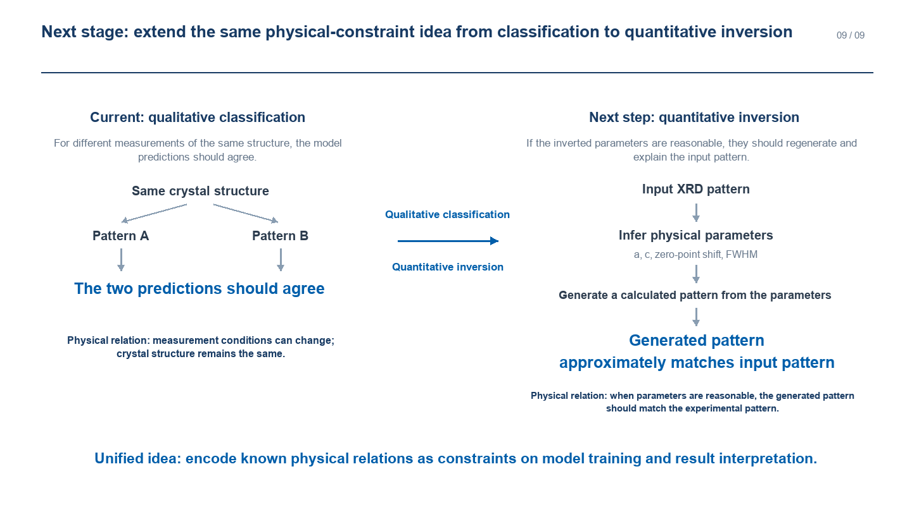

# AI4science: PXRD crystal-system classification

We study whether simulator-retained relationships between measurements of the same crystal improve seven-system PXRD classification, with simulated OOD, CNRS-318 zero-shot, and RRUFF few-shot evaluation.

**Presentation:** [English PDF](docs/showcase/AI4science_showcase_EN.pdf) ? [English PowerPoint](docs/showcase/AI4science_showcase_EN.pptx).

**Evidence and reproducibility:** [Results](xrd_robustness/reports/RESULTS.md) · [Parent-budget report](xrd_robustness/reports/PARENT_BUDGET_EFFICIENCY.md) · [Validation JSON](xrd_robustness/reports/validation_results.json) · [Simulated-test JSON](xrd_robustness/reports/simulated_test_results.json) · [RRUFF JSON](xrd_robustness/reports/rruff301_fewshot_results.json) · [Experiment contract](xrd_robustness/README.md) · [Manuscript](xrd_robustness/MANUSCRIPT.md).

**Project records:** [Current state](docs/CURRENT_STATE.md) ? [Data and reproducibility](docs/DATA_AND_REPRODUCIBILITY.md) ? [Research history](docs/PROJECT_HISTORY.md) ? [Citation](CITATION.md) ? [License](LICENSE) ? [Third-party notices](THIRD_PARTY_NOTICES.md).
