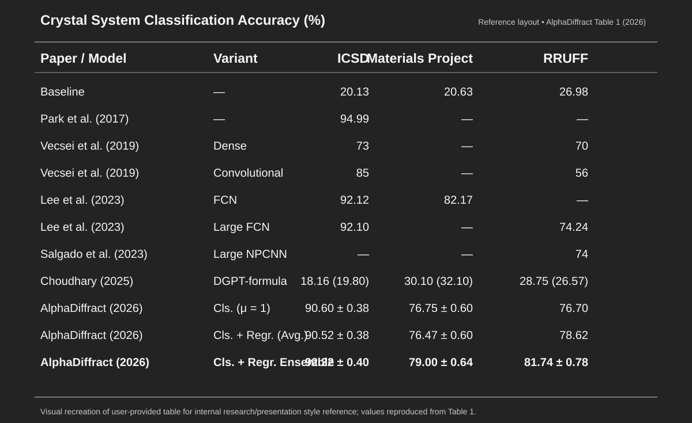

# RRUFF zero-shot model comparison library — 2026-11-03

> **Role:** User-approved, source-attributed, presentation-ready *comparison library*. One paper may contribute multiple distinct model variants. This file is a **literature reference**, not a head-to-head test on common RRUFF IDs. It does not change the owner's five-paper 60/80/full acceptance hierarchy or the three research outcomes (RRUFF Accuracy, independent-CIF data-efficiency curve, ECE).

## Reference presentation style (user selection)

The figure is a **readable SVG recreation of the user's screenshot**, not the source paper's native artwork or a direct export of the screenshot. **Figure source:** Andrejevic et al., *AlphaDiffract* (2026), Table 1, [arXiv 2603.23367v1](https://arxiv.org/html/2603.23367v1). Dark charcoal background, white concise text, light horizontal rules, clear model/variant columns, bold only the notable numerical entries. For future supervisor slides, *replace dataset columns with RRUFF-focused columns unless multiple domains are actually evaluated*. Preserve citations and paper/model variant/source protocol footnotes. Never combine simulated and real Accuracies without indicating the dataset.

## A. Owner-approved grading references — *zero labeled RRUFF adaptation*

| Grade tier | Paper / model variant | RRUFF crystal-system Accuracy | Labeled RRUFF used to fit model | RRUFF cohort caveat / extra information |
| --- | --- | ---: | ---: | --- |
| **Pass/60** | **Lee et al., 2023 — Large FCN** | **74.24%** | **0** | ~1,600 collected; highest-background 40% removed; retained IDs / denominator Unknown |
| **Pass/60** | **Salgado et al., 2023 — Large NPCNN synthetic-only** | **~74%** | **0** | Different from the ~452 real-training 'Large Souping' 86% result; RRUFF cohort lacked trigonal |
| **80 (primary)** | **Andrejevic et al., 2026 — AlphaDiffract Cls.+Regr. Ensemble** | **81.74 ± 0.78%** | **0** | 734 curated RRUFF classification patterns incl. 59 calculated from single-crystal observations; RRUFF noise statistics and evaluation informed development; 10-model ensemble |
| **Full/100** | **Cao et al., 2025 — SimXRD-4M CNN11** | **89.3%** | **0** | exact Table 5 RRUFF test denominator/IDs Unknown |
| **Full/100** | **Cao et al., 2025 — XQueryer-NoElem** | **91.5 ± 1.5%** | **0** | 1,003 selected RRUFF profiles; elemental metadata input disabled |

**Definition:** 'Zero-shot' here means no labeled RRUFF training or fine-tuning, **not necessarily** 'RRUFF measurements never informed augmentation, hyperparameter choice, or other upstream decisions'; AlphaDiffract is explicitly RRUFF-informed. Do not optimize our own final checkpoints using held-out RRUFF. Original sources and screening audits: [literature benchmark](RRUFF_REAL_DOMAIN_LITERATURE_BENCHMARK_2026-10-22.md) and [five-paper cohort audit](RRUFF_FIVE_PAPER_COHORT_SOURCE_AUDIT_20261103.md).

## B. Newly approved model-variant comparison entries (not new acceptance tiers)

| Paper / model variant | RRUFF crystal-system Accuracy | Original source of the number | Input and comparison status |
| --- | ---: | --- | --- |
| **Vecsei et al. (2019) — Dense network / MLP** | **70.0%** | AlphaDiffract 2026 Table 1, citing Vecsei et al. 2019 | Simulated train → measured RRUFF; paper-specific cohort; numeric score not re-evaluated on our cohort |
| **Vecsei et al. (2019) — Convolutional / CNN** | **56.0%** | AlphaDiffract 2026 Table 1, citing Vecsei et al. 2019 | Same historical paper, different architecture. The 85% in the ICSD column is **synthetic ICSD**, not real RRUFF |
| **Choudhary (2025) — DiffractGPT DGPT-formula** | **28.75%** (source also shows **26.57%** in parentheses) | **AlphaDiffract 2026 Table 1 re-evaluated this model on its own RRUFF test dataset** | Uses **chemical formula** alongside PXRD and is a **different generative/structure inference setup**; this 28.75% should **NOT** be presented as an author-published RRUFF claim or an equal-PXRD-input comparator. Exact parenthetical protocol remains source-as-written |

**References:** Vecsei et al., *Neural network based classification of crystal symmetries from x-ray diffraction patterns*, Phys. Rev. B **99**, 245120 (2019), https://doi.org/10.1103/PhysRevB.99.245120 . Choudhary, *DiffractGPT*, J. Phys. Chem. Lett. **16**, 2110–2119 (2025), https://doi.org/10.1021/acs.jpclett.4c03137 . AlphaDiffract Table 1 https://arxiv.org/html/2603.23367v1 (this is specifically the secondary source of all three of the above numbers).

## C. Additional **same-paper, same-RRUFF-protocol** model variants worth retaining

Cao et al., **SimXRD-4M**, ICLR 2025 **Table 5**, trained/validated on SimXRD and evaluated on the same stated RRUFF panel:

| Model variant | RRUFF seven-system top-1 Accuracy |
| --- | ---: |
| CNN11 | **89.3%** |
| CNN7 | 86.8% |
| CNN10 | 85.9% |
| Bidirectional-GRU | 80.4% |
| CNN9 | 79.2% |
| Bidirectional-LSTM | 78.8% |
| GRU | 77.4% |
| LSTM | 72.3% |
| PatchTST | 72.3% |
| MLP | 32.5% |
| Transformer | 35.4% |

**Source:** https://proceedings.iclr.cc/paper_files/paper/2025/file/b04843d76c9f090beca55f335c4ea6bf-Paper-Conference.pdf (Table 5). All entries above are **model variations in ONE research paper**, **not 11 independent new papers**, and not newly designated grading targets. This within-paper architecture table is a useful reference for our own CNN11-vs-ResNet development; its absolute accuracy still should not be conflated with the differently filtered AlphaDiffract or XQueryer cohorts.

## D. Other contextual comparisons, excluded from the strict zero-labeled-RRUFF/PXRD-only list

| Model / paper | Reported RRUFF Accuracy | Why separate |
| --- | ---: | --- |
| Salgado 2023 — *Large Souping* | 86% | ~452 labeled real RRUFF samples included in training; **not zero-shot** |
| Cao et al., 2025 — XQueryer with elemental composition | 93.3% | Element metadata is supplied; **not PXRD-only** (NoElem = 91.5%) |
| Park et al., 2017 — CNN | 94.99% **ICSD**, *not RRUFF* | Do not insert 94.99% into an RRUFF Accuracy ranking |
| Lee et al., FCN (different paper/model) | 82.17% **Materials Project**, *not RRUFF* | Do not insert as RRUFF |

## E. Five-column deliverable rule and presentation usage

When adding a **new paper**, collect **(1) original paper and model variant, (2) unique training CIF parents or curated structure records, (3) *actual* evaluated RRUFF spectrum count, (4) RRUFF crystal-system top-1 Accuracy, (5) labeled RRUFF training/fine-tuning count**. Flag Unknown, distinguish a reported paper number from a third-party re-evaluation, and note non-PXRD inputs.

For **weekly/supervisor slides**, show a short AlphaDiffract-style table with `Paper / Model | Training CIFs | RRUFF Test N | RRUFF Accuracy`; use bold face for the owner's model, the key threshold, or top verified result. Put RRUFF real-label adaptation count / domain use in a concise footnote if needed. The owner's fixed grade targets remain: Pass Lee+Salgado synthetic-only; 80 AlphaDiffract; Full SimXRD CNN11+XQueryer-NoElem. The other two project headlines are the **data-efficiency curve and ECE**; neither changes the Accuracy scorecard.

**Image provenance:** The user supplied a screenshot of AlphaDiffract Table 1 (929×514 px) in the 2026-11-03 conversation and specifically approved its black-background minimalist layout. This repository includes the above vector re-creation for durable display. The exact original screenshot is preserved in the conversation attachment / separately exported local artifact, rather than being misrepresented as this SVG.
