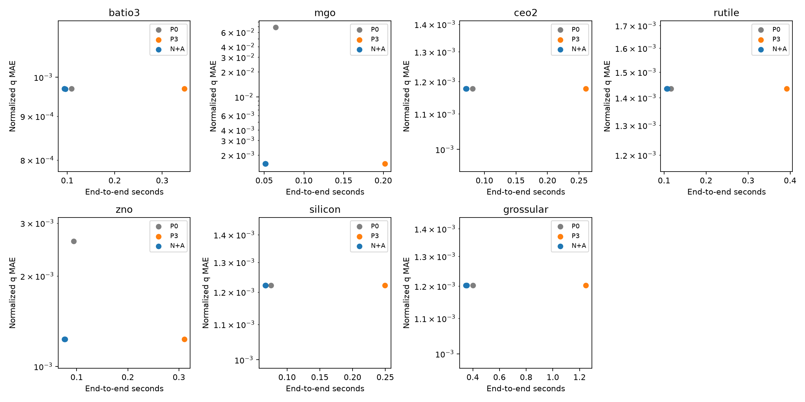

# 跨材料 PXRD 自动实验：结果与边界

**交付状态：PARTIAL。** 已完成 7 种材料、21 个模型的预注册试验；七晶系分类主线及历史反演记录未改变。

神经初值相对完整三起点物理法的耗时标记，不能直接当成神经网络的准确率增益。P0 单中性起点也是必须比较的强基线。下表同时给出三者；没有证据支持跨材料零样本泛化或真实 XRD 有效性。

|材料|P0 q-MAE|P3 q-MAE|N+A q-MAE（均值±SD）|P0/P3/N+A 平均秒|预注册标记|
|---|---:|---:|---:|---|---|
|batio3|0.000969017|0.000969055|0.000969271 ± 3.5e-07|0.1092/0.3465/0.0946|NEURAL_RUNTIME_PARETO|
|mgo|0.0683306|0.00158069|0.00158076 ± 4.7e-07|0.0642/0.2022/0.0514|NEURAL_RUNTIME_PARETO|
|ceo2|0.00117749|0.00117745|0.00117734 ± 2.7e-07|0.0810/0.2607/0.0709|NEURAL_RUNTIME_PARETO|
|rutile|0.00143433|0.00143426|0.0014345 ± 1.6e-07|0.1162/0.3915/0.1068|NEURAL_RUNTIME_PARETO|
|zno|0.00260799|0.00123167|0.00123154 ± 4e-07|0.0943/0.3105/0.0765|NEURAL_RUNTIME_PARETO|
|silicon|0.00122159|0.00122158|0.00122151 ± 2.8e-07|0.0751/0.2496/0.0669|NEURAL_RUNTIME_PARETO|
|grossular|0.0012025|0.0012022|0.00120193 ± 1.7e-07|0.4026/1.2469/0.3517|NEURAL_RUNTIME_PARETO|

P0 的参数误差明显较大的材料包括 MgO、ZnO。其余五种材料的 P0 已达到相近精度；神经初值相对 P3 的节时不能当成相对最便宜充分基线的同等收益。所有主要 N+A/P3 对照均未观察到额外参数精度或可靠性提升。

本次 q=(cell/reference_cell−1)/0.02，不同于历史 du/dv log-lattice 坐标，不能直接横比旧 q-MAE；晶胞误差另以 Å 报告。三点局部 Jacobian 条件数约13–19；门槛没有随结果修改。

晶格误差（Å）按 a 或 a,c 分列，详见 [材料汇总](MATERIAL_SUMMARY.csv)；每个方法、种子的均值/中位/p95、边界、收敛、实际评估次数见 [完整对照](COMPARISON.csv)。不同自由度不混合平均。P0/P3 各有77个父样本；N+A 为同77个父样本的三种子模型，并非231个独立样本。

CUDA训练/验证墙钟 20.41 秒（非设备 kernel 利用时间）；主试验总墙钟 991.29 秒；运行目录约 47.01 MB。训练采用小型 MLP，主要耗时在 CPU 物理精修。完整训练成本及摊销后的推理时间另列，未藏入推理结论。

P3 计入全部三次优化，主对照的评估预算高于单起点。另有总 maxfun=600 的敏感性对照：P3每次200，P0/N+A各600。SciPy数值导数批次可能超限，实际 nfev 已保留；这不是严格等墙钟对照。计时顺序固定，较小差异需谨慎解释。

**保留的失败与未运行项。** 12个来源候选尝试中，9个身份与许可可核验；两项 COD 身份不符，forsterite 下载失败。calcite、corundum 为三方结构，当前参数化不支持，明确跳过。七种支持材料包含立方、四方、六方三个晶系，不能写成七种晶系。来源审计见 [source_audit](../source_audit.json) 与 [下载记录](../source_fetch_attempts.json)。

N+B 因 NumPy 物理层没有 autograd 而 SKIPPED；低噪声条件 NOT_RUN。原始主试验的独立压力臂保留其 NOT_RUN 记录；另在主测试打开后登记并执行独立渲染器/峰形/二次背景失配压力测试，使用每种材料16个新父样本，不重训或替换主结论。详见下方补充记录。主试验仍是同生成器、固定分数坐标的 Gaussian 运动学模型及 V9-like 扰动子集，不含 texture、Kα双线或真实仪器失配。物理 gate 的三点对角 q、两个内部恢复案例不代表全参数域或真实谱可恢复。

所有优化器失败、边界命中、多起点分歧和受限预算下的未收敛均保留在逐样本记录。PASS 只表示执行完成。原始预注册 decision 字段不改写；同时展示 P0，防止把多跑三次的成本误认成 AI 必需性。管理器因两项跳过返回 BLOCKED；本交付将完成的支持子集与扩展缺口合并标为 PARTIAL。

配置 SHA256：`f74942f5542560bb302bd90d0e64239b6a0ff1999065ee7a56909fc40a27ec35`；预注册 SHA256：`7e630b7bc4198ec0cef99b6be7056e0b41b6d230cf9e11dd63801db7620508c8`。完整源码/CIF SHA 与命令硬件信息：[manifest](../runs/pilot_20261019/manifest.json)、[environment](../runs/pilot_20261019/environment.json)、[inventory](../runs/pilot_20261019/inventory.json)。

18项主流程CPU测试和3项独立渲染压力工程测试通过，覆盖安全恢复、冻结篡改、失败留存、门槛阻断、无泄漏、物理对称/单位、CPU夹具流程和指标重算。最终 verify 对逐样本结果重算并检查工件哈希。复现命令见 README；生成谱和最终权重仅保留在 ignored private/，未上传。

**独立渲染失配补充（探索性）。** 主测试打开后另行登记，使用112个新父样本和原有21个选定模型，不重训、不选择、不替换主测试。独立 pymatgen 峰表、0.7 Gaussian + 0.3 Lorentzian 峰形和未建模二次背景；执行与重算均 PASS。新场景中 P0/P3/N+A 精度接近，未观察到神经初始化的额外参数精度或可靠性收益。16个父样本/材料不足以证明广泛等效或真实域适用性。

|Stress material (n=16)|P0 q-MAE|P3 q-MAE|N+A q-MAE mean|
|---|---:|---:|---:|
|batio3|0.00266497|0.00266512|0.00266496|
|mgo|0.00166383|0.00166441|0.00166532|
|ceo2|0.00104055|0.00104044|0.00104061|
|rutile|0.00109309|0.00109303|0.0010924|
|zno|0.00134085|0.00134033|0.00134053|
|silicon|0.00143103|0.00143139|0.00143121|
|grossular|0.000953722|0.000954034|0.00095369|

补充执行 111.28 秒；从首次主训练启动到补充结束总墙钟 1119.11 秒，均在原8小时上限内。CUDA训练/验证总墙钟仍为20.41秒，没有增加训练。主试验与补充共保留5950条方法/种子/父样本记录；不把三种子重复当作独立父样本。

补充 [原始报告](../stress/results_20261019/OVERVIEW.md)、[对照 CSV](../stress/results_20261019/COMPARISON.csv)、[独立登记](../stress/PREREGISTRATION.md)、[冻结哈希](../stress/results_20261019/manifest.json)。执行器原始状态和失败保留原样，总交付 PARTIAL 来自来源及不支持参数化的扩展缺口，已支持的7材料主试验和补充均完成。

完整失败计数（包括每个未被P3选中的起点）见 [FAILURES.json](FAILURES.json)。本结果没有解决历史真实 Garnet 的结构/仪器失配和多初值稳定性问题。
