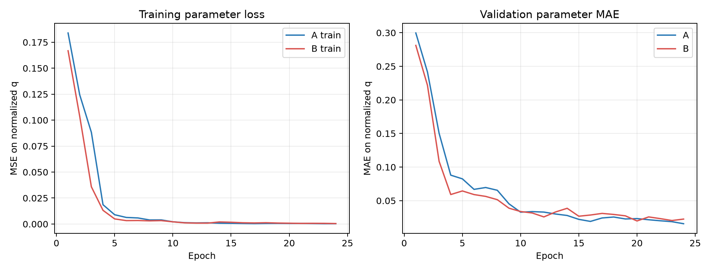
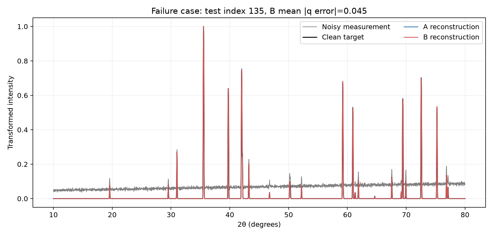

# Forward Reconstruction Loss Pilot Report

**Status:** `PRELIMINARY_PAIRED_AB_PILOT` — executed on a single known tetragonal parent. The result is a method-engineering demonstration, not a ferroelectric-ceramic or experimental-data claim.

## Question and design

Does adding differentiable full-profile reconstruction to supervised continuous regression improve lattice-parameter prediction when the candidate structure is known?

| Item | Protocol |
|---|---|
| Parent | Materials Project record `mp-1007758`, HfCd, tetragonal SG 129, 4 sites; selected from the frozen source `train` fold |
| Parameters | Normalized tetragonal lattice coordinates `du,dv`, each sampled in `[-0.8,0.8]`; zero shift fixed at 0, FWHM fixed at 0.08° |
| Profiles | Cu Kα, 10–80° 2θ, 0.02° step; existing differentiable tetragonal forward model |
| Data | 512 Sobol parameter draws; 358 train / 77 validation / 77 test, all from a fixed parent; independent Poisson measurement noise at 40,000-count scale plus a 100–200 count linear background |
| Model | Existing ResNet-18-GN with two bounded continuous outputs; small regression-head initialization avoids immediate tanh saturation |
| Method A | Mean-squared error on normalized `du,dv` |
| Method B | The same model and parameter loss plus `lambda × transformed-profile MSE` between differentiable forward output and noisy input |
| Optimization | Adam, lr `0.0005`, batch 32, 24 epochs, 288 updates per fit, matched seeds `20261021/22/23`; validation-best checkpoint by normalized-q MAE |
| Lambda | Selected on validation only from `{0.1, 1.0, 10.0}`; `lambda=1.0` had the lowest validation q-MAE (`0.03118`) |

Training, validation, and test are disjoint parameter draws from the same known structure. That is intentional for a conditional known-candidate inverse task; it does not test transfer to unseen structures. Neither the original frozen validation/test structures nor the independent renderer holdout were opened.

## Numerical gate

The `du,dv` Jacobian at `q=[0.11,-0.13,0,-1]` had rank 2, condition number `3.3598`, and singular values `[39.4990, 11.7564]`. Best central finite-difference relative L2 errors were `5.85e-6` for `du` and `1.15e-6` for `dv`. The reconstruction-loss gradient through predicted parameters matched finite differences to relative errors `3.25e-7` and `1.38e-6`. The GPU A/B smoke path completed finite-loss updates for both methods.

## Held-out results

Values are mean ± sample SD across three matched seeds; each test run contains 77 patterns. Seed-level results and paired differences are in `reports/pilot_20261018/results.json`.

| Metric | A: supervised | B: supervised + reconstruction | B minus A |
|---|---:|---:|---:|
| Mean normalized `du,dv` MAE | `0.01495 ± 0.00327` | `0.01509 ± 0.00120` | `+0.00014` (slightly worse) |
| `du` MAE | `0.00862 ± 0.00180` | `0.00712 ± 0.00105` | `−0.00150` |
| `dv` MAE | `0.02129 ± 0.00507` | `0.02307 ± 0.00191` | `+0.00178` |
| Lattice `a` MAE (Å) | `0.000342 ± 0.000081` | `0.000313 ± 0.000028` | `−0.000029` |
| Lattice `c` MAE (Å) | `0.001520 ± 0.000317` | `0.001602 ± 0.000103` | `+0.000082` |
| Clean transformed-profile RMSE | `0.009008 ± 0.001868` | `0.008497 ± 0.000602` | `−0.000511` |
| Noisy transformed-profile RMSE | `0.068729 ± 0.000207` | `0.068655 ± 0.000066` | `−0.000074` |

The reconstruction loss lowered clean-profile RMSE by about 5.7%, but the two-coordinate mean MAE was about 0.9% higher. B improved `du` and `a` while worsening `dv` and `c`; paired mean q-MAE was better for two of three seeds but slightly worse overall. With only three seeds and one parent, these small differences are descriptive, not a stable effect estimate. In this pilot, better spectral similarity did **not** imply better parameter accuracy.

The worst B seed-1 test case is dataset index 135, near the lower `dv` boundary: target `(-0.4582,-0.7988)`, A prediction `(-0.4547,-0.7267)`, B prediction `(-0.4616,-0.7112)`. B's mean absolute q error was `0.0455` versus A's `0.0378` on that case. The overlay is [`failure_case_overlay.png`](reports/pilot_20261018/failure_case_overlay.png).





## Compute and reproduction

On an NVIDIA GeForce RTX 4060 Laptop GPU, average training time was 12.77 s for A and 15.15 s for B per 24-epoch fit (288 updates), with measured peak allocated memory of approximately 654 MB and 793 MB, respectively. A separate architecture-level benchmark on 77 profiles measured 0.274 ms/profile for NN inference and 0.384 ms/profile for NN plus a forward reconstruction check. That benchmark used random initialization and is a throughput measurement, not final-checkpoint quality or final-model latency.

The original head initialization produced a degenerate first run: `tanh` saturated both outputs at `(+0.8,+0.8)`, making A/B predictions identical. That run is preserved under `reports/degenerate_run_20261018/` and is excluded from the comparison above. One engineering correction initialized the continuous output head with standard deviation `0.001`; the second run used fresh Sobol/split/noise seeds while retaining the planned model family, loss definitions, lambda candidates, and matched training budget.

Reproduce from the repository root in the configured CUDA environment:

```powershell
$env:PYTHONPATH = "xrd_forward_loss/src;xrd_inversion/src;xrd_robustness/src"
& .\.venvs\xrd_test\Scripts\python.exe xrd_forward_loss\scripts\run_pilot.py
& .\.venvs\xrd_test\Scripts\python.exe xrd_forward_loss\scripts\benchmark_inference.py
```

The run record is `reports/pilot_20261018/run_manifest.json`; it includes data/config hashes, seeds, the base Git commit, package versions, device, split indices, and SHA-256 hashes for the exact source files used. The run began from the recorded base commit with the pilot files in the working tree; those file hashes preserve the executed snapshot. Seed-1 test `du,dv` predictions, lambda selection, gradient gate, histories, costs, plots, and compact data provenance are stored alongside it. No checkpoint was added to the frozen classification study.

## Interpretation and next gate

The gate supports using this existing forward implementation to train a narrowly scoped `du,dv` regression model for this one parent. The pilot does not show that reconstruction loss improves parameter accuracy, nor that it supplies a better traditional-refinement initialization. The next scientific step is to replace HfCd with the collaborator-confirmed ferroelectric family, verify phase-specific CIFs and parameter identifiability, then use prototype-grouped parent splits and a physics-only refinement comparator. The current result does not authorize mixtures, phase fractions, real-data claims, or broad family generalization.
